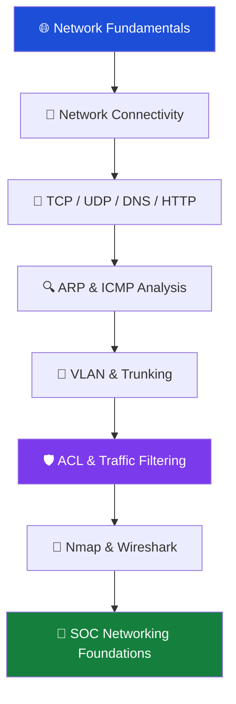

# 🌐 Welcome to My SOC Networking Labs

### Building Strong Networking Foundations for Cybersecurity

**Hands-on Learning | Network Analysis | Cisco Packet Tracer | Security Fundamentals**

---

## 🖥️ Network Architecture Visualization

---

## 👨‍💻 About This Portfolio

Welcome to my practical SOC Networking Labs portfolio.

This repository brings together seven hands-on networking projects completed as part of my cybersecurity learning journey.

My focus is to understand how networks communicate, how protocols operate, how traffic flows, and how networking knowledge supports security monitoring and threat detection.

## 🚀 My Hands-on Networking Projects

| No. | Project | Repository |
|---|---|---|
| 01 | Networking Basics | [View Lab 1](https://github.com/SanthoshCyber-Soc/Networking-Lab-1) |
| 02 | TCP, UDP, DNS & HTTP | [View Lab 2](https://github.com/SanthoshCyber-Soc/Networking-Lab-2) |
| 03 | Firewall ACL & Traffic Filtering | [View Lab 3](https://github.com/SanthoshCyber-Soc/Networking-Lab-3) |
| 04 | ARP & ICMP Analysis | [View Lab 4](https://github.com/SanthoshCyber-Soc/Networking-Lab-4) |
| 05 | Nmap & Wireshark | [View Lab 5](https://github.com/SanthoshCyber-Soc/Networking-Lab-5) |
| 06 | PC-to-PC Connectivity | [View Lab 6](https://github.com/SanthoshCyber-Soc/Networking-Lab-6) |
| 07 | VLAN & Trunking | [View Lab 7](https://github.com/SanthoshCyber-Soc/Networking-Lab-7) |

---

## 🛠️ Tools & Technologies

- Cisco Packet Tracer
- Kali Linux (Lab Environment)
- Nmap
- Wireshark

## 🎯 Skills Practiced

- Network Fundamentals
- TCP/IP Communication
- ARP & ICMP Analysis
- DNS & HTTP Traffic
- VLAN & Network Segmentation
- Access Control Lists (ACL)
- Network Host Discovery
- Packet Analysis

## 🛡️ SOC Analyst Relevance

These practical exercises help build the networking foundation required for:

- Understanding normal network traffic
- Recognizing unusual network communication
- Analyzing network protocols
- Understanding network segmentation
- Supporting security monitoring and investigation

## 📌 Learning Philosophy

**Learn → Configure → Test → Analyze → Document**

---

*This portfolio represents hands-on educational lab practice and continuous cybersecurity learning.*

**Understand the Network. Analyze the Traffic. Build Security Foundations.**
